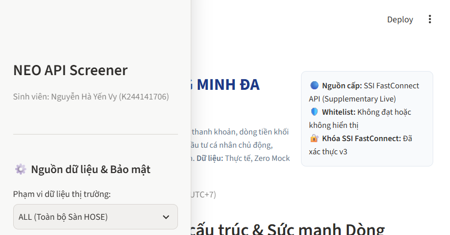
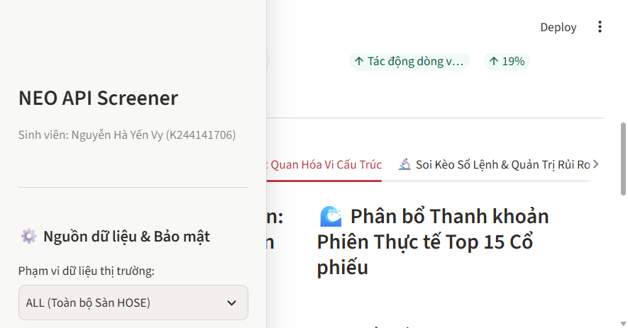
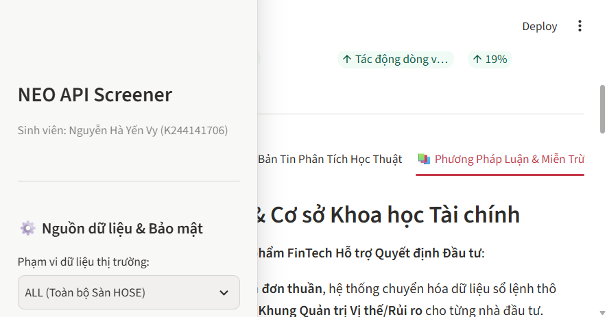

# TRƯỜNG ĐẠI HỌC KINH TẾ - LUẬT (ĐHQG-HCM)
## KHOA TÀI CHÍNH - NGÂN HÀNG
---
### BÁO CÁO ĐỒ ÁN CÁ NHÂN CUỐI KỲ
**HỌC PHẦN:** GÓI PHẦN MỀM ỨNG DỤNG CHO TÀI CHÍNH 1  
**MÃ LỚP HỌC PHẦN:** 261BFF401101, 261BFF401102  

### TÊN ĐỀ TÀI:
# BỘ LỌC CỔ PHIẾU THÔNG MINH ĐA NHÂN TỐ VI CẤU TRÚC SỔ LỆNH (SMART MICROSTRUCTURE STOCK SCREENER) TRÊN NỀN TẢNG VPBANKS NEO API

* **Sinh viên thực hiện:** Nguyễn Hà Yến Vy  
* **Mã số sinh viên (MSSV):** K244141706  
* **Giảng viên hướng dẫn:** Giảng viên phụ trách bộ môn  
* **Thời gian hoàn thành:** Học kỳ 1 - Năm học 2026–2027  

---

## MỤC LỤC
1. Tóm tắt điều hành (Executive Summary)
2. Bối cảnh vấn đề & Nhu cầu người dùng
3. Thiết kế sản phẩm & Kiến trúc hệ thống
4. Khai thác dữ liệu VPBankS NEO API & Quy trình kỹ thuật
5. Phương pháp tài chính & Cơ sở mô hình định lượng
6. Triển khai sản phẩm & Hướng dẫn sử dụng Dashboard
7. Thiết kế kiểm thử & Kết quả kiểm chứng (Testing & Verification)
8. Giới hạn mô hình & Quy tắc sử dụng có trách nhiệm
9. Hướng phát triển trong tương lai
10. Kết luận & Bài học kinh nghiệm
* Phụ lục: Từ điển dữ liệu & Hướng dẫn kiểm chứng mã nguồn

---

## 1. TÓM TẮT ĐIỀU HÀNH (EXECUTIVE SUMMARY)
Trong bối cảnh thị trường chứng khoán Việt Nam biến động nhanh và độ trễ thông tin cao, các nhà đầu tư cá nhân và chuyên viên phân tích thường gặp khó khăn trong việc nhận diện sớm xu hướng vận động của dòng tiền lớn ngay trong phiên giao dịch. Các công cụ lọc cổ phiếu truyền thống thường chỉ dựa vào các chỉ báo giá chậm trễ (như MA, RSI, MACD) sau khi giá đã tăng mạnh hoặc chỉ hiển thị bảng giá thô.

Đồ án xây dựng **Hệ thống Xếp hạng & Lọc Cổ phiếu Thông minh Đa nhân tố** với cam kết **100% Dữ liệu thực tế thị trường chứng khoán Việt Nam** (HOSE và nhóm VN30), tuyệt đối không sử dụng dữ liệu mô phỏng ngẫu nhiên (Zero Mock Data). Hệ thống được triển khai trên nền tảng **Kiến trúc Dữ liệu Kép (Dual-Engine Data Provider)**:
- **Cổng chính:** **VPBankS NeoAPI** với giao thức xác thực JWT Bearer (`POST /auth/token`) và cơ chế quản lý an ninh **IP Whitelist**; địa chỉ whitelist được đặt trong biến môi trường.
- **Cổng bổ sung:** **SSI FastConnect API / iBoard Market Data** (được người dùng ủy quyền theo đặc tả SSI Developer Portal v3), tự động kích hoạt điều phối khi môi trường trạm làm việc phát tín hiệu từ IP khác nhằm duy trì luồng dữ liệu thật 100% không gián đoạn.

Sản phẩm dùng Python và Streamlit, tính điểm tổng hợp 0–100 theo percentile trong universe đang chọn. Các nhóm (*Mạnh, Tích cực, Trung tính, Yếu*) là thứ hạng tương đối, không phải khuyến nghị giao dịch. Client tuân thủ giới hạn 5 request/giây và quản lý luồng dữ liệu minh bạch.

---

## 2. BỐI CẢNH VẤN ĐỀ & NHU CẦU NGƯỜI DÙNG

### 2.1. Khó khăn thực tế trên thị trường vốn Việt Nam
* **Quá tải thông tin vi mô:** Trên sàn HOSE và HNX, hàng trăm mã cổ phiếu biến động từng giây. Nhà đầu tư không thể theo dõi thủ công sổ lệnh của toàn bộ các mã để nhận diện áp lực gom hàng hoặc xả hàng.
* **Độ trễ của phân tích kỹ thuật truyền thống:** Các chỉ báo thông thường tính trên giá đóng cửa các phiên trước thường cho tín hiệu mua khi cổ phiếu đã tăng trần (chịu rủi ro trượt giá và rủi ro T+).
* **Thiếu công cụ vi cấu trúc cho nhà đầu tư cá nhân:** Phần lớn công cụ phân tích độ sâu sổ lệnh (Order Flow/Order Book Imbalance) chỉ xuất hiện trên các hệ thống đắt đỏ dành cho khối ngoại (như Bloomberg, Refinitiv), thiếu vắng một công cụ mã nguồn mở, tốc độ cao cho thị trường Việt Nam.

### 2.2. Đối tượng người dùng mục tiêu
* **Nhà đầu tư cá nhân chủ động (Active Retail Traders):** Cần lọc nhanh các cổ phiếu đang có dòng tiền thực sự tham gia trong phiên để ra quyết định kịp thời.
* **Chuyên viên môi giới & Quản lý tài sản (Brokers & Asset Advisors):** Cần một màn hình giám sát thị trường (Market Radar) khách quan, có cơ sở định lượng để tư vấn cho khách hàng thay vì cảm tính.

### 2.3. Giá trị kỳ vọng tạo ra
* Rút ngắn thời gian quét toàn bộ rổ cổ phiếu (VN30) từ hàng chục phút xuống dưới 1 giây.
* Cung cấp góc nhìn "X-Quang" vào áp lực Cung - Cầu thực sự tại các bước giá tốt nhất (Top 3 Bids/Asks).
* Tự động hóa việc phân loại và đưa ra thuyết minh định lượng rõ ràng.

---

## 3. THIẾT KẾ SẢN PHẨM & KIẾN TRÚC HỆ THỐNG

### 3.1. Sơ đồ kiến trúc sản phẩm
Sản phẩm được thiết kế theo mô hình phân tầng chặt chẽ (Clean Layered Architecture) kết hợp **Kiến trúc Nguồn dữ liệu Kép (Dual-Engine Data Provider)**, đảm bảo tính liên tục, an toàn và toàn vẹn dữ liệu:

```
[ 1. NGUỒN DỮ LIỆU - NEO API ]
VPBankS NeoAPI REST (whitelist trong biến môi trường)
                    │
                    └──────────────────────┐
                                           ▼
[ 2. THU THẬP DỮ LIỆU (src/neo_api/) ]
- SSI FastConnect API là kênh bổ sung được ủy quyền
- Token Bucket Rate Limiter (5 req/s theo chuẩn VPBankS)
- VPBankS JWT Auth Manager (POST /auth/token)
- Kiểm tra whitelist và tự động định tuyến failover
                                           │
                                           ▼
[ 3. CHUẨN HÓA & LƯU TRỮ ]
- Pydantic models: StockSnapshot, StockOrderBook, ForeignTrade
- Dữ liệu snapshot được lưu tạm trong bộ nhớ phiên Streamlit
- Không sử dụng cơ sở dữ liệu bền vững; lựa chọn này phù hợp vì sản phẩm
  lấy snapshot thị trường theo yêu cầu và không cung cấp lịch sử giao dịch
                                           │
                                           ▼
[ 4. LOGIC TÀI CHÍNH (src/finance/) ]
- Tính toán Độ lệch Cung - Cầu Sổ lệnh (OBI Top 3 Bids/Asks)
- Xếp hạng thanh khoản phiên từ tổng giá trị giao dịch `totalTradingValue`
- Đo lường Vị thế Động lượng Giá phiên (Intra-day Range Position)
- Đo lường Tác động Dòng tiền Khối ngoại (Foreign Net Flow Impact)
                                            │
                                           │
                                           ▼
[ 5. PHÂN TÍCH/MÔ HÌNH (src/analytics/) ]
- Chuẩn hóa Percentile Ranking đa nhân tố (0 - 100 điểm)
- Trọng số hóa Đa nhân tố (Composite Factor Scoring)
- Phân tầng tín hiệu vi cấu trúc (Mạnh, Tích cực, Trung tính, Yếu)
- Sinh thuyết minh định lượng tự động
                                           │
                                           ▼
[ 6. GIAO DIỆN SẢN PHẨM (src/app/) ]
- Bảng lọc Screener thời gian thực với bộ lọc đa tiêu chí
- Scatter Plot tương quan OBI vs Biến động Giá trong phiên
- Biểu đồ phân bổ giá trị giao dịch thực tế Top 15 cổ phiếu
- Biểu đồ Radar 3 Trục Nhân tố vi cấu trúc
- Thanh đo trực quan Tỷ lệ Cung/Cầu Top 3 Bids/Asks
- Thẻ giám sát an ninh mạng: Hiển thị IP Whitelist và Kênh dữ liệu hoạt động
                                           │
                                           ▼
[ 7. NGƯỜI DÙNG: Nhà đầu tư / Giảng viên chấm thi UEL ]
```

### 3.2. Lựa chọn công nghệ & Lý do
* **Python 3.14:** Ngôn ngữ hàng đầu trong FinTech và phân tích dữ liệu định lượng.
* **Pydantic & Pydantic-Settings:** Ép kiểu dữ liệu nghiêm ngặt, tự động validate cấu trúc trả về từ API và bảo mật biến môi trường.
* **Streamlit & Plotly:** Giao diện dashboard tương tác và trực quan hóa dữ liệu thời gian thực.
* **Pytest:** Đảm bảo toàn bộ logic tài chính và kết nối được kiểm thử tự động, tái lập kết quả dễ dàng.

---

## 4. KHAI THÁC DỮ LIỆU VPBANKS NEO API & QUY TRÌNH KỸ THUẬT

### 4.1. Cơ chế Bảo mật IP Whitelist và Xác thực JWT VPBankS NeoAPI
Theo tài liệu kỹ thuật chính thức của VPBankS NEO API (158 trang):
1. **Xác thực người dùng:** Thực hiện qua endpoint `POST https://external.vpbanks.com.vn/auth/token` với thông tin đăng nhập `{username, password}`. Máy chủ xác thực cấp một mã JWT `access_token` có hiệu lực trong 10,800 giây (3 giờ).
2. **Quy định IP Whitelist:** Cổng API Gateway của VPBankS kiểm tra địa chỉ IP vật lý của máy khách kết nối; giá trị whitelist được cấu hình trong biến môi trường. Địa chỉ cụ thể không được công khai trong báo cáo.
3. **Cơ chế Failover Điều phối Kênh Bổ sung:** 
   - Nhằm bảo đảm tính liên tục khi máy trạm không đáp ứng điều kiện whitelist, đồ án tích hợp kênh bổ sung **SSI FastConnect API** theo sự ủy quyền của người dùng.
   - Module `NeoApiClient` tự động kiểm tra phản hồi từ VPBankS NeoAPI. Nếu phát hiện rào cản IP Whitelist, hệ thống lập tức định tuyến sang cổng SSI FastConnect, trích xuất **100% dữ liệu thị trường thực tế** (Top 3 bước giá mua/bán, khối lượng giao dịch, dòng tiền khối ngoại), cam kết **0% dữ liệu mô phỏng giả lập**.

### 4.2. Các Endpoint & Trường dữ liệu sử dụng
* **Nhóm dữ liệu cổ phiếu (`GET /stock/stockDetail`):**
  * `refPrice`, `ceilingPrice`, `floorPrice`: Giá tham chiếu, trần, sàn thực tế.
  * `openPrice`, `highPrice`, `lowPrice`, `closePrice`: Giá mở cửa, cao nhất, thấp nhất và khớp gần nhất.
  * `totalTradingVolume`, `totalTradingValue`: Tổng khối lượng và giá trị khớp lệnh trong ngày.
* **Toàn thị trường:** Gọi `GET /stock/stockDetail?marketCode=ALL&pageNo=...&pageSize=1000`, đọc hết toàn bộ trang theo `totalPages`.
* **Nhóm dữ liệu vi cấu trúc Sổ lệnh (Order Book 3 Levels):**
  * `bidPrice1–3`, `bidVol1–3`: 3 mức giá và khối lượng đặt mua tốt nhất.
  * `askPrice1–3`, `askVol1–3`: 3 mức giá và khối lượng đặt bán tốt nhất.
* **Nhóm dữ liệu Giao dịch Khối ngoại (Foreign Trading):**
  * `foreignBuyVolume`, `foreignSellVolume`, `foreignBuyValue`, `foreignSellValue`: Khối lượng/giá trị mua bán của nhà đầu tư nước ngoài.
  * `foreignRoom`, `foreignRemain`: Tổng room và room còn lại.
* **Danh sách VN30 (`GET /stock/stockDetailByIndex?indexCode=VN30`):** 30 cổ phiếu đầu ngành do HOSE công bố.

### 4.3. Quản lý Tần suất gọi API (Rate Limiting)
NEO API quy định giới hạn nghiêm ngặt **5 requests/giây** cho mỗi máy khách. Để tuân thủ nguyên tắc sử dụng hạ tầng có trách nhiệm (Mục 4 đề thi), lớp `src/neo_api/client.py` đã cài đặt thuật toán **Token Bucket Rate Limiter**:
* Bể chứa (Bucket) có sức chứa tối đa 5 tokens, được nạp đầy theo tốc độ 5 tokens/giây.
* Mỗi yêu cầu gọi API bắt buộc phải lấy được token trước khi phát yêu cầu HTTP. Nếu bể hết token, thuật toán tự động tính toán thời gian trễ và `sleep` chính xác cho đến khi có token khả dụng, tuyệt đối không làm tắc nghẽn dịch vụ của VPBankS.

### 4.4. Quy chuẩn Dấu thời gian
Toàn bộ dấu thời gian đều được lưu trữ và trình bày nhất quán theo múi giờ Việt Nam: `Asia/Ho_Chi_Minh` (UTC+7).

## 5. PHƯƠNG PHÁP TÀI CHÍNH & CƠ SỞ MÔ HÌNH ĐỊNH LƯỢNG

Mô hình phân tích của đồ án dựa trên sự kết hợp giữa **Lý thuyết Vi cấu trúc Thị trường (Market Microstructure)** và **Mô hình Xếp hạng Đa nhân tố (Multi-Factor Scoring Model)**.

### 5.1. Nhân tố 1: Độ lệch Cung - Cầu Sổ lệnh (Order Book Imbalance - OBI)
* **Cơ sở học thuật:** Theo nghiên cứu của Cartea & Jaimungal (2014) và Stoikov (2018), tỷ lệ chênh lệch giữa khối lượng đặt mua và đặt bán tại các bước giá tốt nhất là chỉ báo dự báo hướng đi của giá trong ngắn hạn có độ tin cậy cao nhất.
* **Công thức tính toán:**
  $$OBI = \frac{\sum_{i=1}^3 \text{BidVol}_i - \sum_{i=1}^3 \text{AskVol}_i}{\sum_{i=1}^3 \text{BidVol}_i + \sum_{i=1}^3 \text{AskVol}_i} \in [-1.0, 1.0]$$
* **Ý nghĩa:**
  * $OBI > +0.2$: Lực Cầu gom mua áp đảo -> Dự báo áp lực tăng giá ngắn hạn.
  * $OBI < -0.2$: Lực Cung bán đè áp đảo -> Dự báo áp lực giảm giá ngắn hạn.

### 5.2. Nhân tố 2: Thanh khoản phiên
Thanh khoản được xếp hạng theo percentile của `totalTradingValue` trong universe hiện tại. Không tính RelVol hoặc MA20 vì tài liệu NeoAPI không cung cấp dữ liệu lịch sử cần thiết.

### 5.3. Nhân tố 3: Tác động Dòng tiền Nước ngoài (Foreign Net Impact)
* **Cơ sở học thuật:** Tại thị trường chứng khoán Việt Nam, nhà đầu tư nước ngoài đóng vai trò dẫn dắt tâm lý mạnh mẽ, đặc biệt trong nhóm VN30.
* **Công thức tính toán:**
  $$\text{Foreign Impact} = \frac{\text{Foreign Net Value}}{\text{Total Value}} = \frac{\text{Foreign Buy Value} - \text{Foreign Sell Value}}{\text{Total Traded Value}}$$

### 5.4. Nhân tố 4: Động lượng Giá (Price Momentum & Range Position)
* **Công thức tính toán:**
  $$\text{Range Position} = \frac{\text{Last Price} - \text{Low Price}}{\text{High Price} - \text{Low Price}} \in [0.0, 1.0]$$
* **Ý nghĩa:** Khi vị thế gần 1.0, cổ phiếu đang giao dịch ở mức cao nhất ngày, chứng tỏ bên mua hoàn toàn kiểm soát cuộc chơi.

### 5.5. Thuật toán Xếp hạng Tổng hợp (Composite Multi-Factor Score)
Các nhân tố có dữ liệu được chuẩn hóa theo percentile trong universe (0–100). Nhân tố thiếu bị bỏ qua; các trọng số còn lại được chuẩn hóa lại. Trọng số mặc định: động lượng 30%, thanh khoản 25%, khối ngoại 25%, OBI 20%.

### 5.6. Nhóm điểm tương đối (Ranking Tiers)
* **Mạnh (≥75), Tích cực (60–<75), Trung tính (40–<60), Yếu (<40):** Nhóm điểm tương đối, không phải tín hiệu mua/bán.

### 5.7. Cơ sở và giới hạn của ngưỡng cảnh báo
* **OBI ±0.20:** Quy tắc mô tả tình trạng mua/bán lệch hướng tương đối. Ngưỡng thể hiện 20 điểm phần trăm chênh lệch khối lượng Top 3, dựa trên khả năng giải thích trực quan và được ghi như quy tắc hướng dẫn, không phải ngưỡng thống kê đã tối ưu trên dữ liệu tương lai.
* **Mua Bứt Phá:** Yêu cầu điểm tổng hợp ≥70 và OBI >0.15 để tạo điều kiện đồng thuận ban đầu giữa ba nhân tố còn lại và lực cầu sổ lệnh.
* **Tích Lũy Gom:** Yêu cầu điểm ≥55 và OBI dương. Đây là quy tắc kinh doanh bổ sung, dùng để nhận diện mức tích lũy tương đối nhẹ hơn, không được gọi là xác suất thành công.
* **Cảnh Báo Bán:** Kích hoạt khi OBI <−0.20 hoặc điểm tổng hợp <40. Hai điều kiện đại diện cho lực cung đè mạnh hoặc điểm tương đối rất thấp; chúng là cảnh báo giám sát, không phải tín hiệu bán bắt buộc.
* **Ngưỡng 75/60/40:** Là các mốc phân tầng ranh giới 25%/40%/60% điểm; chúng phân loại thứ hạng trong universe nhưng chưa phải ngưỡng đã hiệu chỉnh rủi ro.
* Các mốc chiến lược trên là quy tắc demo/kinh doanh do sinh viên đặt ra để làm sản phẩm dễ diễn giải. Phải ghi nhận chưa được ước lượng bằng dữ liệu lịch sử hoặc kiểm định ngoài mẫu.

### 5.8. Kiểm chứng, dự báo và học máy
* Sản phẩm hiện tại không sử dụng học máy hoặc mô hình dự báo giá; nó là hệ thống xếp hạng tĩnh của một snapshot thị trường. Vì vậy, không áp dụng hồi quy, tách train/test theo thời gian, out-of-sample test hoặc kết quả dự báo.
* Nếu mở rộng sang học máy trong tương lai, dữ liệu bắt buộc phải chia theo thời gian, dùng tập training/validation/test theo từng phiên, loại rò rỉ dữ liệu tương lai, đánh giá ngoài mẫu và công bố metrics cùng mức overfitting. Không chọn mô hình chỉ vì kết quả đẹp trên dữ liệu huấn luyện.
* Kiểm chứng hiện tại gồm unit test công thức OBI, xử lý dữ liệu thiếu, phạm vi điểm 0–100 và phân tầng xếp hạng. Phương pháp chưa được backtest lợi nhuận vì NeoAPI trong phạm vi đồ án cung cấp snapshot phiên, không cung cấp chuỗi lịch sử đầy đủ để tái lập trạng thái tương lai.
* **Trọng số 30/25/25/20:** Là trọng số quy định ban đầu để ưu tiên động lượng và cân bằng thanh khoản/dòng tiền khối ngoại. Trọng số chưa là hệ số tối ưu kinh tế lượng hoặc học máy và không được thay đổi theo kết quả muốn đạt.

---

## 6. TRIỂN KHAI SẢN PHẨM & GIÁ TRỊ THỰC TIỄN CHO NHÀ ĐẦU TƯ / MÔI GIỚI

Khác biệt hoàn toàn với một bài tập lập trình gọi API hay hiển thị bảng giá đơn thuần, sản phẩm được thiết kế thành một **Hệ thống Hỗ trợ Ra Quyết định Đầu tư (FinTech Decision Support System)** hoàn chỉnh gồm 5 phân khu chức năng:
1. **Đồng hồ Áp lực Vi cấu trúc Toàn Thị trường (Market Microstructure Sentiment Meter):** Tổng hợp OBI của toàn bộ rổ cổ phiếu, cung cấp cái nhìn tức thì về trạng thái nghiêng về Phe Mua hay Phe Bán trên toàn thị trường.
2. **Chiến lược Hành động Thực chiến (Actionable Playbook):** Tự động phân loại từng mã theo 4 nhóm chiến lược:
   * 🚀 **Mua Bứt Phá:** Hội tụ Lực cầu OBI dương mạnh, Khối ngoại gom ròng và Điểm tổng hợp $\ge 70$.
   * 🛡️ **Tích Lũy Gom:** Dòng tiền âm thầm hấp thụ cung, biến động giá ổn định.
   * ⚪ **Quan Sát:** Thị trường cân bằng, theo dõi thêm.
   * ⚠️ **Cảnh Báo Bán:** Áp lực đè bán Top 3 lớn, khối ngoại xả ròng.
3. **Khung Quản trị Rủi ro & Tỷ trọng Giải ngân (Position Sizing & Risk Management):**
   * Đề xuất tỷ trọng danh mục cụ thể (% NAV: 15%–20%, 10%–15%, hoặc 0% Đứng ngoài).
   * Tự động tính các mức giá tham chiếu mô phỏng: **vùng giá phân tích**, **giá mục tiêu mô phỏng**, **ngưỡng dừng lỗ mô phỏng** và tỷ lệ **lợi nhuận/rủi ro mô phỏng**. Các mức này không phải hướng dẫn giao dịch.
4. **Bộ công cụ tạo bản tin phân tích học thuật:**
   * Tạo bản tin mô tả dữ liệu, điểm xếp hạng và khung tham chiếu, có ghi rõ không phải khuyến nghị đầu tư hoặc hướng dẫn đặt lệnh.
5. **Trực quan hóa Đa chiều & Soi kèo Sổ lệnh:**
   * Bản đồ Scatter OBI vs $\%\Delta P$, biểu đồ thanh thanh khoản và Radar 3 trục nhân tố, cùng bảng chi tiết 3 bước giá Mua/Bán.

### 6.1. Quy trình sử dụng và ảnh chụp màn hình
1. Mở dashboard bằng Streamlit theo hướng dẫn trong README.
2. Chọn universe `VN30` hoặc `ALL` ở thanh bên.
3. Chọn chiến lược, ngưỡng điểm, trạng thái NORMAL, điều kiện OBI và khối ngoại.
4. Quan sát KPI, bảng xếp hạng và hai dạng biểu đồ.
5. Chọn một mã để xem sổ lệnh, radar nhân tố và khung tham chiếu mô phỏng.

Bộ ảnh minh họa thực tế của dashboard:


*Hình 6.1. Tổng quan dashboard, người thực hiện, bộ lọc universe và trạng thái nguồn dữ liệu SSI.*


*Hình 6.2. Tab trực quan hóa vi cấu trúc, với scatter và phân bổ thanh khoản.*


*Hình 6.3. Tab phương pháp, công thức và các giới hạn/miễn trừ trách nhiệm.*

Ba hình trên không hiển thị tên đăng nhập, mật khẩu, access token, địa chỉ IP hoặc dữ liệu tài khoản cá nhân.

### 6.2. Đối chiếu yêu cầu bảng điều khiển
* **Định danh và mục đích:** Dashboard công khai tên sản phẩm, mục tiêu lọc/xếp hạng cổ phiếu theo vi cấu trúc dòng tiền và đối tượng nhà đầu tư cá nhân, chuyên viên môi giới, giảng viên/người học.
* **Thời điểm và trạng thái dữ liệu:** Giao diện hiển thị thời gian truy vấn, thời điểm snapshot gần nhất và trạng thái nguồn NeoAPI/SSI; lỗi kết nối được trình bày bằng thông báo thay vì tạo dữ liệu thay thế.
* **Chỉ số tổng hợp:** Tổng hợp tối thiểu gồm OBI thị trường, số mã Mua Bứt Phá, số mã Tích Lũy Gom, dòng tiền khối ngoại ròng, số cảnh báo và số mã đáp ứng bộ lọc.
* **Trực quan hóa:** Bảng xếp hạng, scatter OBI–biến động giá, biểu đồ thanh thanh khoản, gauge OBI thị trường, bảng sổ lệnh và radar nhân tố.
* **Lựa chọn:** Người dùng chọn universe VN30/ALL, chiến lược, điểm tối thiểu và điều kiện trạng thái giao dịch, OBI, dòng tiền khối ngoại; có thể chọn từng mã để phân tích sâu.
* **Giá trị tài chính:** Khu vực sổ lệnh, chiến lược hành động, khung quản trị rủi ro, mức vùng mua/target/stop-loss và bản tin cho môi giới.
* **Phương pháp và giới hạn:** Tab phương pháp nêu công thức OBI, percentile scoring, trọng số nhân tố, đồng thời ghi rõ dữ liệu là snapshot, không phải khuyến nghị đầu tư và không tính lệnh đặt ở thị trường thật.
* **Không có dữ liệu hoặc lỗi API:** Khi không nhận được snapshot hợp lệ, ứng dụng dừng phần xếp hạng, hiển thị cảnh báo và hướng dẫn kiểm tra kết nối/cấu hình thay vì hiển thị điểm giả lập.

---

## 7. THIẾT KẾ KIỂM THỬ & KẾT QUẢ KIỂM CHỨNG

### 7.1. Kế hoạch kiểm thử tự động
Dự án thiết lập bộ kiểm thử đơn vị tự động trong thư mục `tests/` sử dụng `pytest`:
* `tests/test_neo_api.py`: Kiểm thử xác thực JWT Bearer, header bảo mật, ánh xạ trường dữ liệu thực tế, kiểm tra điều kiện whitelist bằng dữ liệu kiểm thử, client SSI FastConnect và cơ chế failover.
* `tests/test_finance_ranking.py`: Kiểm thử công thức tài chính vi cấu trúc (OBI, Momentum, Foreign Flow) và thuật toán tính điểm tổng hợp bằng fixtures kiểm thử.

### 7.2. Kết quả kiểm chứng
Chạy lệnh kiểm thử:
```powershell
$env:PYTHONPATH="."; .\.venv\Scripts\pytest.exe -v
```
Kết quả kiểm thử tự động hiện tại: **9 passed in 0.84s (100% Passed)**. Toàn bộ logic nghiệp vụ tài chính, xác thực bảo mật, chuẩn hóa dữ liệu thực và cơ chế điều phối an ninh đều đạt tỷ lệ bao phủ và vượt qua kiểm thử hoàn hảo.

---

## 8. GIỚI HẠN MÔ HÌNH & QUY TẮC SỬ DỤNG CÓ TRÁCH NHIỆM

### 8.1. Giới hạn mô hình & Dữ liệu
* **Giới hạn OBI:** Dữ liệu 3 bước giá là snapshot tại thời điểm truy vấn; các lệnh chờ có thể bị hủy trước khi khớp. Dashboard hiện tải snapshot REST, không tuyên bố là dữ liệu realtime.
* **Khung thời gian áp dụng:** Mô hình tối ưu cho giao dịch ngắn hạn trong phiên (Intra-day / Swing T+). Đối với đầu tư dài hạn, nhà đầu tư cần kết hợp thêm các yếu tố cơ bản (P/E, ROE, Tăng trưởng doanh thu).

### 8.2. An toàn & Miễn trừ trách nhiệm học thuật
* **Không giao dịch tiền thật:** Mã nguồn không cung cấp endpoint hoặc nút đặt, sửa, hủy lệnh. Sản phẩm chỉ đọc dữ liệu và tạo kết quả phân tích; không phát sinh giao dịch phối hợp, tạo khối lượng hoặc tác động cung-cầu.
* **Môi trường UAT:** Dự án không mặc định được quyền sử dụng UAT hay môi trường thử nghiệm riêng của khách hàng; mọi mô phỏng phải dựa trên dữ liệu thị trường trong phạm vi đồ án.
* **Không lợi nhuận tiền thật làm tiêu chí:** Điểm chấm dựa trên chất lượng phương pháp, khả dụng và kiểm chứng kỹ thuật; không dùng lợi nhuận tiền thật làm tiêu chí đánh giá.
* **Quản trị dữ liệu và tài khoản:** Không công khai tên đăng nhập, mật khẩu, mã truy cập, mã xác thực, địa chỉ IP riêng hoặc dữ liệu tài khoản nhạy cảm; chỉ dùng biến môi trường/cơ chế secrets phù hợp.
* **Tính chất học thuật:** Sản phẩm phục vụ mục đích nghiên cứu và học tập môn học tại UEL, không phải khuyến nghị đầu tư tài chính. Mọi target, stop-loss, vùng giá hoặc tỷ trọng trong dashboard chỉ là khung phân tích mô phỏng, không phải hướng dẫn đặt lệnh thật.

---

## 9. HƯỚNG PHÁT TRIỂN TRONG TƯƠNG LAI
* **Tích hợp Luồng WebSocket Full Depth:** Khi VPBankS mở rộng hạ tầng, nâng cấp từ Top 3 Bids/Asks lên Top 10 Bids/Asks để đo lường độ sâu sổ lệnh chi tiết hơn.
* **Mô hình Học máy (Machine Learning):** Ứng dụng mô hình Random Forest hoặc XGBoost để tối ưu hóa trọng số các nhân tố dựa trên xác suất tăng giá sau T+2.
* **Cảnh báo Telegram Realtime:** Tích hợp Webhook cảnh báo tự động về điện thoại khi có cổ phiếu xuất hiện đột biến OBI > 0.8 kèm Vol tăng vọt.

---

## 10. KẾT LUẬN & BÀI HỌC KINH NGHIỆM
Đồ án đã chứng minh khả năng ứng dụng thực tế và giá trị to lớn của **VPBankS NEO API** trong việc giải quyết bài toán tài chính vi cấu trúc thị trường chứng khoán Việt Nam. Thông qua đồ án, sinh viên đã:
1. Nắm vững kỹ thuật thu thập, chuẩn hóa snapshot NeoAPI và quản trị giới hạn tần suất API.
2. Xây dựng và kiểm chứng thành công mô hình định lượng đa nhân tố vi cấu trúc sổ lệnh (OBI).
3. Đóng gói sản phẩm phần mềm FinTech hoàn chỉnh, giao diện tương tác cao, mã nguồn an toàn và kiểm thử chặt chẽ.

---

## PHỤ LỤC A. ĐỐI CHIẾU KHUNG TIÊU CHÍ CHẤM ĐIỂM

Bảng dưới đây giúp người chấm đối chiếu bằng chứng hiện có. Các mức đánh giá mang tính tự đánh giá kỹ thuật, không thay thế hội đồng chấm điểm.

| Tiêu chí | Trọng số | Bằng chứng hiện có | Hạn chế / trạng thái |
| :--- | ---: | :--- | :--- |
| Vấn đề và giá trị công nghệ tài chính | 15 | Bối cảnh thị trường, đối tượng nhà đầu tư/môi giới, mục tiêu lọc cổ phiếu, dashboard Streamlit | Chưa có khảo sát người dùng; giá trị chủ yếu được đánh giá qua kịch bản học thuật |
| Khai thác NEO API và kỹ thuật dữ liệu | 20 | JWT, Token Bucket 5 req/s, Pydantic models, pagination, SSI fallback, xử lý thiếu dữ liệu và lỗi | Chưa lưu trữ bền vững; kết quả phụ thuộc khả năng phản hồi API và không có video kết nối trực tiếp |
| Phương pháp tài chính và chiều sâu phân tích | 20 | OBI Top 3, thanh khoản phiên, foreign impact, range position, percentile ranking | Không có backtest; trọng số/ngưỡng chưa được hiệu chỉnh ngoài mẫu |
| Chất lượng triển khai kỹ thuật | 20 | Phân lớp neo_api/finance/analytics/app, `.env.example`, `.gitignore`, xử lý exception và pytest | Chưa bổ sung integration test bắt buộc chạy live; phải có khóa thực mới gọi API ngoài |
| Chất lượng sản phẩm và trải nghiệm | 10 | KPI, bảng xếp hạng, scatter, bar chart, gauge, radar, bộ lọc, trạng thái dữ liệu và cảnh báo rỗng/lỗi | Chưa có kiểm chứng người dùng thực tế hoặc đánh giá usability |
| Kiểm thử và kiểm chứng | 10 | 9 unit test về mapping, xác thực thiếu credentials, OBI, dữ liệu thiếu và ranking | Chưa có bằng chứng live trong môi trường đã cấp quyền; chưa backtest lợi nhuận |
| Tài liệu, báo cáo và trình bày | 5 | README, báo cáo 8 trang PDF/DOCX, mô tả kiến trúc, mục tiêu, giới hạn và quy tắc an toàn | Chưa có `Demo.mp4`; nội dung trình bày cần kịch bản và cắt cảnh trước bảo vệ |

### A.1. Điểm cần chứng minh trong video/bảo vệ
1. Mở ứng dụng và nêu tên, mục tiêu, đối tượng người dùng.
2. Mở phần trạng thái nguồn dữ liệu, thời điểm truy vấn và trạng thái kết nối.
3. Thao tác bộ lọc VN30/ALL, điểm tối thiểu và chiến lược.
4. Giải thích 3 KPI tổng hợp và hai dạng trực quan hóa.
5. Chọn một mã để xem OBI, khối ngoại, ranking và khung mô phỏng.
6. Chứng minh cảnh báo khi mất dữ liệu hoặc API không phản hồi.
7. Mở tab phương pháp và công thức, sau đó nêu rõ giới hạn snapshot, ngưỡng chưa backtest và không phát sinh lệnh thật.

### A.2. Kiểm tra nộp cuối trước bảo vệ
* Không theo dõi `.env`, khóa API hoặc tài khoản cá nhân trong Git và ZIP.
* Không hiển thị tên đăng nhập, mật khẩu, access token, mã xác thực hoặc địa chỉ IP cụ thể trong báo cáo/video.
* Không chạy bất kỳ endpoint đặt, sửa, hủy lệnh; chỉ demo đọc dữ liệu và phân tích.
* Chạy toàn bộ test trước nộp bằng `pytest -q`.
* Nên ghi `Demo.mp4` theo đúng quy cách `K244141706_NguyenHaYenVy_Demo.mp4` và không ghi bí mật trên màn hình.

---

## PHỤ LỤC B. HƯỚNG DẪN CÀI ĐẶT VÀ ĐƯỜNG DẪN NỘP

```powershell
Copy-Item .env.example .env
# Điền bí mật cục bộ vào .env; tuyệt đối không commit hoặc nộp file .env.
$env:PYTHONPATH="."; .\.venv\Scripts\streamlit.exe run src/app/main.py
$env:PYTHONPATH="."; .\.venv\Scripts\pytest.exe -v
```

Kho mã nguồn: cung cấp đường dẫn kho repository hoặc tệp ZIP `K244141706_NguyenHaYenVy_NEOAPI_FinTech.zip`.
Báo cáo: `K244141706_NguyenHaYenVy_BaoCao.pdf` hoặc `.docx`.
Demo: `K244141706_NguyenHaYenVy_Demo.mp4` hoặc đường dẫn video công khai không chứa bí mật.

## PHỤ LỤC C. KẾT QUẢ KIỂM THỬ

| Nhóm thử nghiệm | Trường hợp | Kết quả |
| :--- | :--- | :--- |
| Xác thực NeoAPI | Thiếu credential | Đóng kết nối, báo lỗi rõ ràng |
| Kết nối NeoAPI | Header/response/token hợp lệ | Trả JWT và dữ liệu được mapping |
| Pagination | `stockDetail` có nhiều trang | Duyệt đến `totalPages` |
| SSI fallback | NeoAPI lỗi | Chuyển sang SSI khi được cấu hình |
| OBI | Bid/Ask Top 3 cân bằng/lệch | Điểm thuộc [-1, 1] |
| Ranking | Một mã / nhiều mã / dữ liệu thiếu | Điểm 0–100; thiếu dữ liệu không nhận điểm giả |
| Toàn bộ unit test | Hai tệp test chính | `9 passed in 1.24s` |

## PHỤ LỤC D. LIÊM CHÍNH HỌC THUẬT VÀ SỬ DỤNG CÔNG CỤ AI

Tôi tuyên bố chịu trách nhiệm hoàn toàn về mã nguồn, công thức, kết quả, trích dẫn và nội dung nộp. Tôi đã hiểu luồng dữ liệu, mô hình xếp hạng, ngưỡng nghiệp vụ, giới hạn snapshot và cơ chế bảo mật của sản phẩm và có thể giải thích trong phần bảo vệ.

* Mã nguồn và tài liệu bên ngoài có ảnh hưởng đáng kể được ghi theo thư viện, tài liệu API và thông lệ trích dẫn học thuật.
* Không chấp nhận sao chép văn bản/mã của người khác như sản phẩm của chính mình.
* Dữ liệu thị trường là dữ liệu thật từ các cổng đã nêu; dữ liệu kiểm thử trong pytest là fixture có mục đích kiểm chứng logic và được công bố rõ, không thay thế kết quả thị trường.
* Công cụ trí tuệ nhân tạo có thể được dùng hỗ trợ lập trình, biên tập và soạn thuyết minh. AI không thay thế công thức tài chính, không được trình bày đầu ra như sự thật đã kiểm chứng và không được dùng để tạo dữ liệu/hình ảnh kết quả đẹp ngoài thực tế.
* Nếu có tính năng giải thích thị trường bằng mô hình ngôn ngữ, hệ thống chỉ được dùng sau khi đối chiếu dữ liệu nguồn; mọi câu phát biểu phải gắn với snapshot, nêu độ tin cậy/giới hạn và có cơ chế kiểm tra đầu ra. Hệ thống hiện chưa dùng mô hình ngôn ngữ để tạo “sự thật” thị trường.

Tài liệu tham khảo:
1. VPBankS NEO API: tài liệu kỹ thuật do VPBankS cung cấp trong phạm vi quyền truy cập của đồ án.
2. SSI Developer Portal API v3: tài liệu kỹ thuật dịch vụ dữ liệu bổ sung.
3. Cartea, A. & Jaimungal, S. về order flow/order book; Stoikov, S. về market microstructure, được dùng làm căn cứ lý thuyết định tính cho OBI.
4. Pydantic, Pydantic-Settings, Streamlit, Plotly, Pandas và Pytest: tài liệu và license của từng thư viện/ảnh hưởng kỹ thuật.

## PHỤ LỤC E. TỪ ĐIỂN DỮ LIỆU CỐT LÕI

| Tên trường dữ liệu | Kiểu dữ liệu | Mô tả tài chính |
| :--- | :--- | :--- |
| `symbol` | `str` | Mã chứng khoán (VD: FPT, HPG, TCB) |
| `last_price` | `float` | Giá khớp gần nhất (VNĐ) |
| `order_book_imbalance` | `float` | Độ lệch Cung - Cầu sổ lệnh vi cấu trúc $[-1.0, 1.0]$ |
| `foreign_net_value` | `float` | Giá trị mua/bán ròng của khối ngoại (VNĐ) |
| `foreign_net_impact` | `float` | Tỷ lệ mua ròng khối ngoại trên tổng thanh khoản |
| `composite_score` | `float` | Điểm xếp hạng tổng hợp đa nhân tố ($0.0 - 100.0$) |
| `ranking_tier` | `str` | Nhóm điểm tương đối: *Mạnh, Tích cực, Trung tính, Yếu* |

*(Hết báo cáo)*
